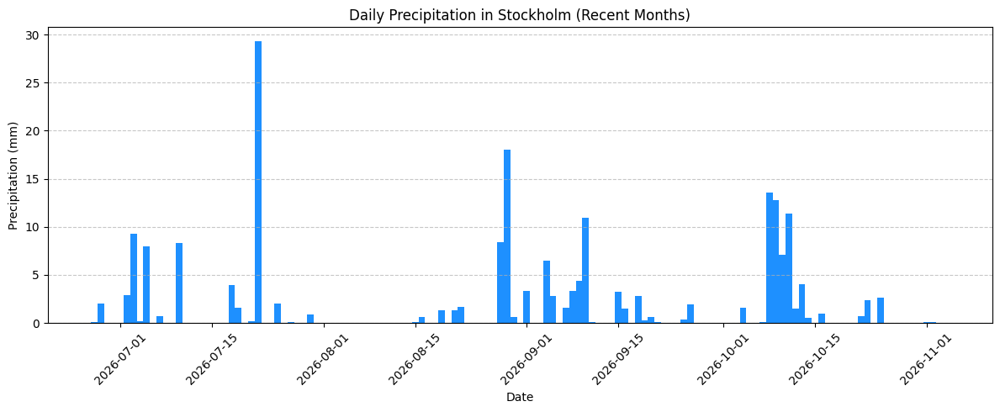
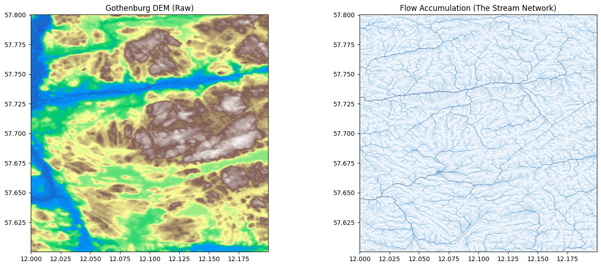
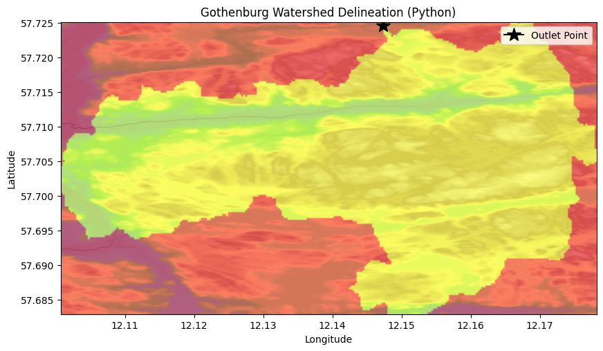

# Python for Hydrology & Water Resources

## 📌 Project Overview
This repository contains a collection of Python workflows designed to automate hydrological data analysis, spatial mapping, and climate data extraction. These scripts demonstrate the transition from traditional GUI-based GIS software (like QGIS) to programmatic, reproducible data science.

## 🛠️ Technical Stack
*   **Data Analysis:** `pandas`, `numpy`
*   **Data Visualization:** `matplotlib`
*   **API & Web Requests:** `requests`
*   **Geospatial Analysis:** `geopandas`, `rasterio`, `shapely`
*   **Hydrological Modeling:** `pysheds`, `elevation`

---

## 🚀 Key Workflows & Outputs

### 1. Climate Data Processing & Visualization (Pandas & Matplotlib)
Loaded and filtered 70+ years of daily weather data to analyze long-term trends and seasonal variations.
*   **Seasonal Curve (1948):** Filtered the dataset to isolate a single year and plotted the smooth, seasonal temperature rise and fall.
*   **Long-term Trend (1940–2015):** Plotted 70 years of daily temperature to identify annual cycles and inter-annual variability.

| Seasonal Temperature (1948) | 70-Year Temperature Trend |
| :---: | :---: |
| .png) | .png) |

### 2. Automated API Integration (SMHI)
Connected directly to the Swedish Meteorological and Hydrological Institute (SMHI) Open Data API. Parsed complex JSON responses into clean Pandas DataFrames and generated precipitation bar charts for Stockholm automatically.
*   **Output:** Daily precipitation events showing distinct heavy rainfall days in the summer and autumn.

### 3. Spatial Hydrology & DEM Processing (GeoPandas & Pysheds)
Downloaded Digital Elevation Models (DEMs) and executed a full hydrological terrain analysis workflow in Python:
*   **Fill Sinks:** Handled artificial pits in raw satellite data.
*   **Flow Direction & Accumulation:** Calculated D8 flow paths and generated the stream network automatically.
*   **Watershed Delineation:** Extracted specific catchment boundaries based on an outlet point (snapped to the highest flow accumulation cell).

| DEM & Flow Accumulation | Watershed Delineation |
| :---: | :---: |
|  |  |

---

## 💻 How to Use
All notebooks are designed to run in **Google Colab**. You do not need to install any software locally. Simply open the `.ipynb` file in Colab and run the cells sequentially. 

## 🔮 Future Additions
*   **Phase 4:** Extreme Value Analysis (Flood Frequency curves using `scipy.stats`).
*   **Phase 5:** Capstone Project (Automated flood risk assessment tool).
